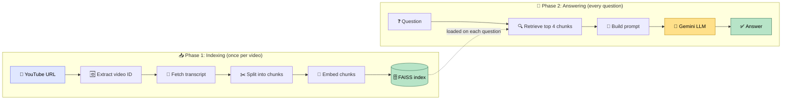
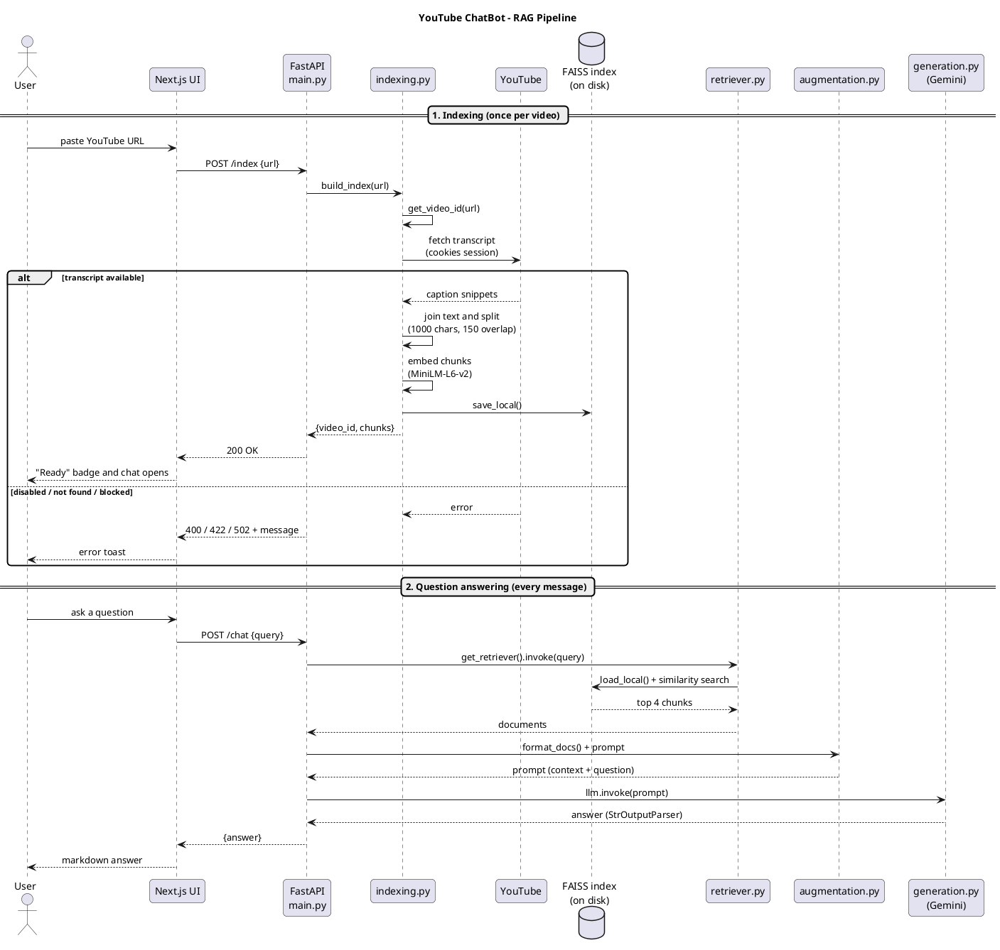

<div align="center">

# 🎬 YouTube ChatBot

**Paste a YouTube link. Ask anything. Get answers grounded in the video's own transcript.**

A full-stack **RAG (Retrieval-Augmented Generation)** app built with FastAPI, LangChain, FAISS, Google Gemini and Next.js.


[Features](#-features) •
[How it works](#-how-it-works) •
[Pipeline diagram](#-pipeline-diagram-plantuml) •
[Quick start](#-quick-start) •
[API](#-api-reference) •
[Troubleshooting](#-troubleshooting)

</div>

---

## ✨ Features

| | |
|---|---|
| 🔗 **Any video, one link** | Works with `watch?v=`, `youtu.be`, `/shorts/` and `/embed/` URLs |
| 🧠 **Answers from the transcript only** | The prompt forbids outside knowledge, so no made-up answers |
| ⚡ **Fast retrieval** | Local FAISS index with the top 4 most relevant chunks per question |
| 💬 **Polished chat UI** | Markdown answers, copy button, typing indicator, suggested questions |
| 🎨 **Modern design** | Dark glassmorphism theme, gradient accents, Framer Motion animations |
| 🛡️ **Friendly errors** | Clear toasts for invalid links, missing captions, YouTube blocks, offline backend |
| 🧩 **One file per RAG stage** | `indexing` → `retriever` → `augmentation` → `generation`, easy to read and swap |

---

## 🧭 How it works

The app has two phases. **Indexing** runs once per video, and **answering** runs on every question.



| Stage | File | What it does |
|---|---|---|
| 1️⃣ Indexing | [`backend/indexing.py`](./backend/indexing.py) | URL → video ID → transcript → chunks (1000 chars, 150 overlap) → embeddings → FAISS saved to disk |
| 2️⃣ Retriever | [`backend/retriever.py`](./backend/retriever.py) | Loads the saved index fresh on each call and returns the top 4 chunks |
| 3️⃣ Augmentation | [`backend/augmentation.py`](./backend/augmentation.py) | Prompt template plus `format_docs()` that joins chunks into the context |
| 4️⃣ Generation | [`backend/generation.py`](./backend/generation.py) | Gemini chat model (temperature 0.2) and a string output parser |
| 🔌 API | [`backend/main.py`](./backend/main.py) | FastAPI app that wires the four stages into one LCEL chain |

The `/chat` endpoint body is a single line that runs the whole chain:

```python
return {"answer": main_chain.invoke(request.query)}
```

---

## 🗺️ Pipeline diagram (PlantUML)

This sequence diagram shows what happens between the browser, the API and each RAG stage.

<div align="center">

![RAG pipeline sequence diagram](https://www.plantuml.com/plantuml/svg/RLNRRXen47ttLuponAg504hx42bLqrk4cWjDG6gaIcXOJy1brtPjBsqKvTyxzh8Bc_Q5e3d7SpbpXhpt0Lseoa845Gg2UrFDgYN1npM63oP07sxFBs2gB1LAa_0RfIqwBC6lKPhVIg_W0GlVGUXNHJgdA_8ULtHUg9M6d7GWTy1ofj8oDqwJWz7m09XoFofN5dMOefInmcWi1ER1E9XxJcBt33YwfZzXyDF3V7846FzquI_em_bqyaENgFJ0FYOI1xeifINzuKeDOVBfUvUmaoM1zpCXCU0IFN7-yydT7QJtFtJFQ93ARxB4Ir0tZQFW56t9DOLkFy-w3AnM9Kk5GPbzk_EBBcb5h5f3uR8NL2gjwgeNdw-5E3k3qG0ckwc0-ye9B2kzLP9C1cTd8Ye9_NSi69o2PPNskv_VNWeECyX2CJgzkPl1SPeHdYfNF8iOPvXbOdXPgK8k4jnZD1CntA8h2ejKTQ5a1xwVCVf08Lz3SAXzxfGDF4nkp4QHPnjvpnDc0ejmm03SeYfmMP20cAFVLihHHad0QsKj1SzufvEVHca8R1T0BS7RGiLoe-5m2FaQdNyDepT3CBoT0ctsyZMLIv9ChFJ6yxCh5lpogd_vjhyT7t1hEvo2noqj2fDZqMlHLi-dHe_NktpFJ4cIDliOSqytNpawtmNZiaxXw9PGiYUMA5UKfk360nXBsWlYAupkYz98E0RDr_iGZuo_BxcL3ScNYf5pnhsiVSArZ-5aFERFDyCnl8AoFkH_sadF8HWsZo0ja-t60_XMaK-Bu9Nz9fSC63t_s2Jwrt_eDu3mQ_VmF-PBSpunmJssxkFRsVchFQjUDb1wQpRKIzHCHCx1MWg3ibaB3-PLoLPoAZoosz3bQr4J-stsO2oSxBPK9siRaoQlugdwfXy-q-XeuqeC2qPzgc6TAMqG4To_hOF0NjV9aA_QsRCc6zznRBWecudgDvc8m3vJhJ7qxeAxgOAj-3VJiRAxD8s-JpNjMNGNMABRy8zuiodndhSO_nNy1G00)

</div>

<details>
<summary><b>📄 View the PlantUML source</b> (paste it into <a href="https://www.plantuml.com/plantuml/uml">plantuml.com</a> to edit)</summary>



</details>

---

## 🧰 Tech stack

| Layer | Technology |
|---|---|
| **Backend** | Python, FastAPI, LangChain (LCEL) |
| **Transcript** | `youtube-transcript-api` with a cookies-authenticated session |
| **Chunking** | `RecursiveCharacterTextSplitter` (1000 chars, 150 overlap) |
| **Embeddings** | `sentence-transformers/all-MiniLM-L6-v2` via `langchain-huggingface` (runs locally, no API key) |
| **Vector store** | FAISS (saved to `backend/faiss_index/`) |
| **LLM** | Google Gemini, `gemini-2.5-flash` by default, configurable |
| **Frontend** | Next.js (App Router), TypeScript, Tailwind CSS, Framer Motion, `react-markdown` |

---

## 📁 Project structure

```text
YouTube-ChatBot/
├── .env.example                  # template for your .env
├── .gitignore
├── backend/
│   ├── indexing.py               # URL → transcript → chunks → FAISS
│   ├── retriever.py              # load FAISS → retriever
│   ├── augmentation.py           # prompt template + context formatting
│   ├── generation.py             # Gemini LLM + output parser
│   ├── main.py                   # FastAPI app (/health, /index, /chat)
│   └── requirements.txt
└── frontend/
    └── src/
        ├── app/                  # layout, global styles, main page
        └── components/
            ├── UrlForm.tsx       # URL input with validation
            ├── VideoCard.tsx     # thumbnail, "Ready" badge, chunk count
            ├── ChatWindow.tsx    # messages, suggestions, input
            ├── MessageBubble.tsx # markdown answers + copy button
            ├── TypingIndicator.tsx
            └── Toast.tsx         # error / success notifications
```

---

## 🚀 Quick start

### 0. Requirements

- Python 3.10+
- Node.js 20+ and npm
- A [Google AI Studio](https://aistudio.google.com/apikey) API key

### 1. Clone and configure

```bash
git clone https://github.com/Og-Brutal/YouTube-ChatBot.git
cd YouTube-ChatBot
cp .env.example .env
```

Open `.env` and set your key:

```env
GOOGLE_API_KEY=your_google_api_key_here
GEMINI_MODEL=gemini-2.5-flash
YOUTUBE_COOKIES_FILE=www.youtube.com_cookies.txt
```

### 2. Add your YouTube cookies

YouTube often blocks anonymous transcript requests, so the backend sends your browser cookies with them.

1. Log in to YouTube in your browser.
2. Export the cookies with the [Get cookies.txt LOCALLY](https://chromewebstore.google.com/detail/get-cookiestxt-locally/cclelndahbckbenkjhflpdbgdldlbecc) extension.
3. Save the file as `www.youtube.com_cookies.txt` in the **project root**.

> [!WARNING]
> Cookies work like a password, and YouTube can ban an account that is used for automated requests. Use a **spare account**, and never commit this file (it is already in `.gitignore`).

### 3. Run the backend

```bash
cd backend
python3 -m venv .venv
source .venv/bin/activate          # Windows: .venv\Scripts\activate
pip install -r requirements.txt
uvicorn main:app --reload
```

The API runs at **http://localhost:8000** (interactive docs at `/docs`).

> The first indexing run downloads the embedding model (about 90 MB). After that it is cached.

### 4. Run the frontend

Open a second terminal:

```bash
cd frontend
npm install
npm run dev
```

The app runs at **http://localhost:3000**. To point it at a different backend, set `NEXT_PUBLIC_API_URL` (default `http://localhost:8000`).

### 5. Use it

1. Paste a YouTube URL and click **Analyze Video**.
2. Wait for the **Ready** badge (the transcript is fetched, chunked and indexed).
3. Ask a question, or click a suggested one. **Enter** sends, **Shift+Enter** adds a new line.

---

## 🔌 API reference

| Method | Endpoint | Body | Returns |
|---|---|---|---|
| `GET` | `/health` | none | `{"status": "ok"}` |
| `POST` | `/index` | `{"url": "https://youtube.com/watch?v=..."}` | `{"video_id": "...", "chunks": 42}` |
| `POST` | `/chat` | `{"query": "What is this video about?"}` | `{"answer": "..."}` |

<details>
<summary><b>Error codes for <code>/index</code></b></summary>

| Status | Meaning |
|---|---|
| `400` | The URL is not a valid YouTube link |
| `422` | Captions are disabled, or no transcript was found |
| `502` | YouTube is blocking the request (refresh your cookies file) |
| `500` | Any other server error |

</details>

<details>
<summary><b>Try it with curl</b></summary>

```bash
curl -X POST http://localhost:8000/index \
  -H "Content-Type: application/json" \
  -d '{"url": "https://www.youtube.com/watch?v=VIDEO_ID"}'

curl -X POST http://localhost:8000/chat \
  -H "Content-Type: application/json" \
  -d '{"query": "Summarize this video"}'
```

</details>

---

## ⚙️ Environment variables

| Variable | Required | Default | Description |
|---|---|---|---|
| `GOOGLE_API_KEY` | ✅ Yes | none | Gemini API key (used for answer generation) |
| `GEMINI_MODEL` | No | `gemini-2.5-flash` | Gemini model used for chat |
| `YOUTUBE_COOKIES_FILE` | ✅ Yes | none (`.env.example` suggests `www.youtube.com_cookies.txt`) | Cookies file path, relative to the project root |
| `NEXT_PUBLIC_API_URL` | No | `http://localhost:8000` | Backend URL used by the frontend |

---

## 🩺 Troubleshooting

| You see | Cause and fix |
|---|---|
| `YouTube is blocking requests` (502) | Your IP or cookies are blocked. Export a fresh cookies file, or try another network such as a phone hotspot |
| `No transcript found` / `Captions are disabled` (422) | The video has no captions in English or Hindi. Try another video |
| `Backend server is offline` toast | Start the API with `uvicorn main:app --reload` in `backend/` |
| `ModuleNotFoundError` on start | Activate the virtual environment and run `pip install -r requirements.txt` again |
| `externally-managed-environment` | You are outside the virtual environment. Activate `.venv` first |
| Wrong or empty answers after switching models | Delete `backend/faiss_index/` and index the video again (the index must be built with the same embedding model that reads it) |

---

## ⚠️ Current limitations

- **One video at a time.** Indexing a new video replaces the previous index.
- **English-focused embeddings.** `all-MiniLM-L6-v2` works best for English text. For Hindi transcripts, switch to a multilingual model such as `paraphrase-multilingual-MiniLM-L12-v2`.
- **Cookies are required** for reliable transcript access, with the account risk described above.

---

## 🛣️ Roadmap

- [x] Transcript indexing with FAISS
- [x] LCEL RAG chain with a grounded prompt
- [x] FastAPI backend (`/index`, `/chat`, `/health`)
- [x] Next.js chat UI with markdown answers
- [ ] Multiple videos with a saved index per video
- [ ] Streaming answers
- [ ] Source citations with timestamps
- [ ] Multilingual embeddings

---

<div align="center">

**Built by [Abdul Wahab](https://github.com/Og-Brutal)** · ⭐ Star the repo if it helped you!

[⬆ Back to top](#-youtube-chatbot)

</div>